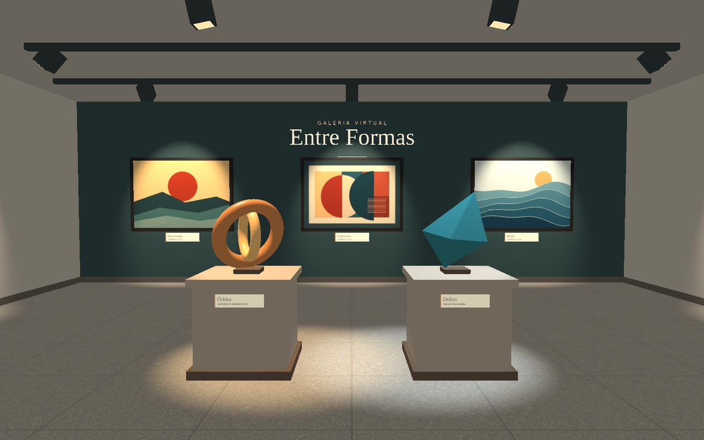

# Entre Formas

Galeria virtual da disciplina de Computação Gráfica do CEFET-MG. A sala tem cinco quadros texturizados, duas esculturas giratórias e um refletor por obra. A visita acontece em primeira pessoa.



## Executar

Use Python 3.10 ou superior, um driver com OpenGL 3.3 Core e uma sessão gráfica. No terminal, dentro da pasta do projeto:

```sh
python3 -m venv .venv
source .venv/bin/activate
python -m pip install -r requirements.txt
python main.py
```

No Windows com PowerShell, use `py -m venv .venv` e `.\.venv\Scripts\python.exe -m pip install -r requirements.txt`. Execute com `.\.venv\Scripts\python.exe main.py`.

Se o Linux acusar ausência de OpenGL ou do backend de janela, confira as bibliotecas do sistema e o driver gráfico. Em Debian/Ubuntu, os pacotes de runtime normalmente usados são `libgl1` e `libglfw3`.

| Controle | Ação |
| --- | --- |
| **W / A / S / D** | Andar pela sala |
| **Mouse** | Olhar ao redor |
| **L** | Alternar os refletores e comparar com a iluminação ambiente |
| **P** | Pausar ou retomar as esculturas |
| **R** | Retornar à posição inicial da câmera |
| **Esc** | Fechar a galeria |

## Personalizar os quadros

Os cinco arquivos de `texturas/01.png` a `texturas/05.png` são ilustrações geométricas que servem como acervo inicial. Substitua um arquivo de mesmo nome ou edite a entrada correspondente em `QUADROS`, em [galeria/cena.py](galeria/cena.py), para apontar para outra imagem PNG ou JPG dentro da pasta `texturas`. A moldura se adapta à proporção da foto. Os números 01–03 seguem da esquerda para a direita na parede do fundo. O 04 fica à esquerda e o 05 à direita. Se trocar o título de uma obra, atualize também o arquivo `legenda-N.png` correspondente.

## Onde estão os conceitos

| Aulas | Arquivo | Aplicação |
| --- | --- | --- |
| 07–14 | [matrizes.py](galeria/matrizes.py), [cena.py](galeria/cena.py) | Cores RGB, translação, rotação, escala e coordenadas homogêneas |
| 15 | [main.py](main.py) | Janela, eventos, teclado e temporização com GLFW |
| 16–17 | [render.py](galeria/render.py), [shaders](shaders) | VAO, VBO, EBO, atributos, GLSL, UV e mipmaps |
| 18–20 | [camera.py](galeria/camera.py), [galeria.vert](shaders/galeria.vert) | Câmera virtual, perspectiva e composição modelo–vista–projeção |
| 22–23 | [malhas.py](galeria/malhas.py) | Toro paramétrico, bipirâmide e triangulação |
| Exercícios de iluminação | [galeria.frag](shaders/galeria.frag) | Phong por fragmento com refletores cônicos |

O [relatório técnico](docs/relatorio.md) detalha as escolhas e registra a verificação.

## Demonstração de até 10 minutos

| Tempo | O que mostrar |
| --- | --- |
| 0–1 min | Apresente o tema, abra a galeria e mostre a vista inicial. |
| 1–3 min | Ande com WASD e mouse e aproxime-se de um quadro lateral. Explique a coordenada UV e os filtros de textura. |
| 3–5 min | Passe perto de um pedestal e use **P**. Mostre a rotação em Y, o toro e a bipirâmide. |
| 5–7 min | Use **L** duas vezes e compare a componente ambiente com os cones. Explique o produto escalar, a atenuação e o brilho especular. |
| 7–9 min | Mostre o shader de vértices e relacione modelo, vista e projeção com a navegação. |
| 9–10 min | Informe o link do repositório do grupo e reserve tempo para perguntas. |

# Galeria_Virtual_Computacao_Grafica
