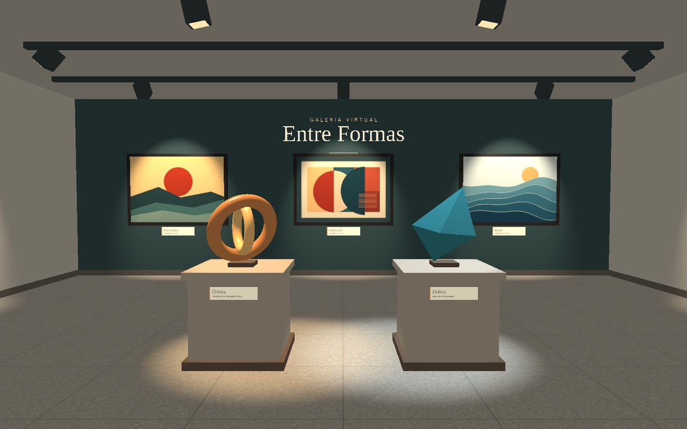

# Entre Formas
## Relatório técnico de Computação Gráfica

**CEFET-MG · Departamento de Computação**  
**Docente** Prof. Dr. Raulivan Rodrigo  
**Equipe** [Preencher com os nomes dos integrantes]  
**Repositório** [Inserir o endereço do GitHub do grupo]

### Resumo

Entre Formas é uma galeria virtual que permite explorar, em primeira pessoa, uma sala com cinco quadros e duas esculturas giratórias. A aplicação usa Python, GLFW e OpenGL 3.3. A geometria é descrita por código e enviada à GPU em malhas trianguladas. Cada obra tem um refletor próprio, calculado no fragment shader com iluminação de Phong, decaimento com a distância e transição suave na borda do cone. A interação permite comparar a iluminação ambiente com a contribuição dos refletores e observar as esculturas em movimento ou paradas.

*Figura 1 — Vista da entrada. Ao fundo, três dos cinco quadros. Em primeiro plano, as esculturas Órbita e Dobra.*

### 1. Construção da cena

O eixo X percorre a largura da sala, Y representa a altura e Z, a profundidade. Paredes, trilhos, molduras e bases reutilizam a mesma malha de cubo com diferentes matrizes de modelo. A sala tem 11 unidades de largura por 10,4 de profundidade e 3,62 unidades de altura. O piso e as imagens dos quadros são retângulos triangulados. Cada vértice tem posição, normal e coordenadas UV. O VBO armazena os atributos, o EBO armazena os índices e o VAO guarda sua configuração. O teste de profundidade mantém visíveis as superfícies mais próximas.

A escultura **Órbita** combina dois toros construídos por amostragem uniforme de dois ângulos. Com raio principal R e raio do tubo r, a posição é dada por `((R + r cos v) cos u, (R + r cos v) sin u, r sin v)`. As normais variam continuamente. A escultura **Dobra** é uma bipirâmide com cintura pentagonal. Cada triângulo tem normal própria, calculada com o produto vetorial das arestas, o que conserva o aspecto facetado. As duas obras recebem rotações em torno de Y. O ângulo cresce com o tempo em segundos, independentemente da quantidade de quadros desenhados.

### 2. Transformações, câmera e projeção

A matriz de modelo combina translação, rotação e escala. Com vetores-coluna, a composição `M = T · R · S` aplica primeiro a escala local e por último posiciona a obra na sala. O shader calcula `p_clip = P · V · M · (x, y, z, 1)`. A cena usa projeção em perspectiva com campo vertical de 50° e planos de corte a 0,07 e 35 unidades. A razão de aspecto vem do tamanho atual do framebuffer.

O mouse controla a direção horizontal e vertical da câmera. WASD desloca o observador no plano XZ, com velocidade ajustada pelo tempo entre quadros. A matriz de vista usa os vetores frente, direita e acima. A câmera fica a 1,59 unidade do piso e tem uma margem de colisão nas paredes e nos pedestais.

### 3. Cor, textura e iluminação

O projeto usa cores RGB para distinguir materiais e fontes de luz. Imagens PNG ou JPG são lidas com Pillow, orientadas conforme os metadados e enviadas para uma textura OpenGL. A GPU interpola as coordenadas UV entre os vértices. O projeto usa filtro linear na ampliação e interpolação trilinear com mipmaps na redução. As imagens dos quadros são ajustadas à moldura preservando a proporção. O piso reutiliza a mesma textura em toda a superfície. A iluminação é calculada em RGB linear e o resultado é convertido para sRGB na saída.

O shader combina iluminação ambiente, difusa e especular. A matriz normal, inversa transposta da parte linear de M, preserva a direção correta depois de escalas diferentes em cada eixo. Para cada refletor, **L** é o vetor unitário do fragmento até a luz e **D** é a direção unitária da fonte até o alvo. O produto escalar `dot(-L, D)` determina se o fragmento está dentro do cone. A função `smoothstep` interpola entre os cossenos do corte externo e do corte interno. Fora do corte externo, a contribuição do foco é zero. Dentro do cone, a parcela difusa depende de `max(dot(N, L), 0)` e o brilho especular depende do alinhamento entre a reflexão da luz e a direção do observador. Ambas sofrem atenuação com a distância.

Os cinco quadros usam luz levemente quente. Os dois pedestais usam temperaturas de cor diferentes para destacar os materiais de Órbita e Dobra. A tecla **L** alterna as sete contribuições focais para comparação durante a demonstração. O modelo calcula iluminação direta sem teste de oclusão entre objetos, por isso a cena não projeta sombras dinâmicas.

### 4. Verificação

A cena foi renderizada em um contexto OpenGL 3.3 Core da Mesa, sem janela. Os shaders compilaram e os desenhos ocorreram sem erros de OpenGL. Foram comparadas capturas mantendo a mesma câmera e ângulo das esculturas, primeiro com os refletores ativos e depois somente com a iluminação ambiente. Com as luzes ativas e a câmera fixa, duas capturas em instantes diferentes confirmaram o efeito da rotação. Uma captura lateral verificou o quadro e o respectivo cone na parede direita. Eventos simulados no laço principal verificaram o movimento, a pausa, o retorno à entrada e a alternância da iluminação. A abertura da janela e os dispositivos de entrada precisam ser conferidos na máquina de apresentação.

| Requisito | Implementação |
| --- | --- |
| RD01–RD03 | Galeria 3D, posições e materiais definidos em Python, com cores RGB. |
| RD04 | Python e shaders GLSL para o processamento na GPU. |
| RD05 | Quadros e piso com imagens mapeadas por UV. |
| RD06 | Iluminação ambiente e sete refletores com difusa, especular e atenuação. |
| RD07 | Câmera virtual em perspectiva com navegação em primeira pessoa. |
| RD08 | Translação, rotação, escala e animação em Y. |
| RD09 | Construção geométrica por código com GLFW e OpenGL. |

### Referências da disciplina

- RODRIGO, Raulivan. *Computação Gráfica*. CEFET-MG. Aulas 07–20 e 22–23, com ênfase em coordenadas homogêneas, pipeline programável, texturas, câmera e representação por malhas.
- RODRIGO, Raulivan. *Cubo com textura e filtros*. Código da Aula 17. O projeto adapta a matriz de perspectiva e a sequência de upload e filtragem de textura. [Exemplo da aula](https://github.com/raulivan/computacao-grafica-python/blob/main/AULA17/cubo_textura.py).
- Exemplo local de prática de iluminação, `iluminacao_de_phong.py`. A galeria usa as mesmas componentes ambiente, difusa e especular, calculadas por fragmento.
